# Gastos Comunes Happy

Dashboard financiero **local y privado** para analizar las cartolas mensuales de gastos comunes emitidas por **Comunidad Feliz**.

Cargas los PDF de tus cartolas y el dashboard extrae egresos, fondos, agua caliente, caja y tu obligación individual. Concilia los movimientos contra los totales impresos y muestra tendencias, alertas y análisis por categoría y proveedor. Es un único archivo HTML que se abre con doble clic.

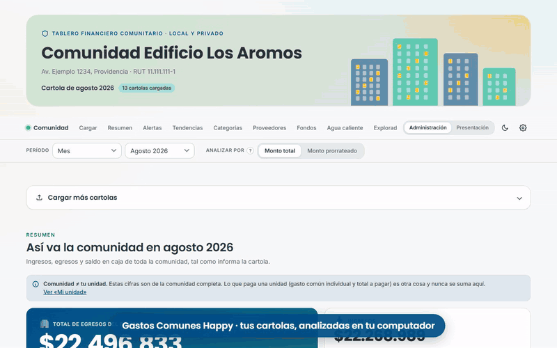

*Recorrido de 15 segundos con datos ficticios ([ver en MP4](docs/video/demo.mp4) · [versión vertical de 40 s para redes sociales](docs/video/demo-vertical.mp4)).*

> [!IMPORTANT]
> **Tus datos nunca salen de tu computador.** Todo se procesa dentro de tu navegador. No hay servidor, no hay cuentas y no se sube nada a internet. La página bloquea toda conexión de red mediante una política de seguridad (Content-Security-Policy), con una sola excepción opcional: el botón **Buscar actualizaciones**, que solo consulta en GitHub cuál es la última versión publicada. Los PDF y los datos extraídos quedan guardados solo en el almacenamiento local de tu navegador.

> [!WARNING]
> **Aviso de responsabilidad.** Este dashboard es un proyecto personal y **puede contener errores** de lectura, de cálculo o de interpretación. No reemplaza la revisión de las cartolas originales ni la información oficial de tu administración. **El uso es de exclusiva responsabilidad de quien lo utiliza.** Verifica siempre las cifras importantes contra la cartola original antes de tomar decisiones o compartirlas. No es un producto de Comunidad Feliz ni está afiliado a esa empresa.

---

## Cómo se usa

### 1. Descargar
**[⬇ Descargar dashboard-comunidad.html](https://github.com/KikeMuller/GastosComunesHappy/releases/latest/download/dashboard-comunidad.html)** (última versión) y guárdalo en una carpeta de tu computador.

También lo encuentras, junto con las notas de cada versión, en la página de [releases](https://github.com/KikeMuller/GastosComunesHappy/releases).

No necesitas instalar nada: ni Node.js, ni servidores, ni extensiones.

### 2. Abrir
Haz doble clic en `dashboard-comunidad.html`. Se abre en tu navegador. Recomendado: **Microsoft Edge** o **Google Chrome** actualizados.

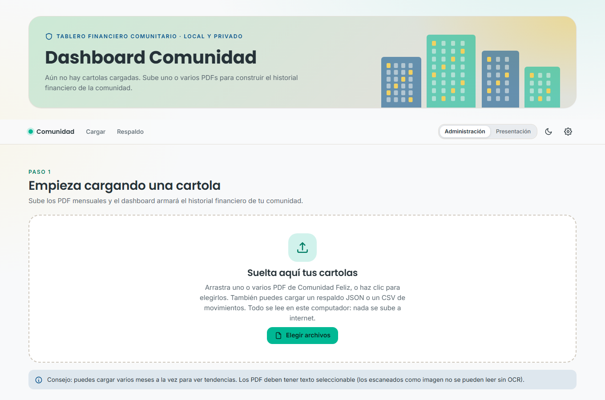

### 3. Cargar tus cartolas
Arrastra uno o varios PDF de tus cartolas de Comunidad Feliz a la zona de carga, o usa **Elegir archivos**. El dashboard muestra la lista con el mes y la comunidad detectados. Luego presiona **Procesar**.

- Puedes cargar varios meses a la vez para ver tendencias.
- Los PDF deben tener texto seleccionable. Los escaneados como imagen no se pueden leer.
- Si cargas un mes que ya existe, te pregunta si quieres reemplazarlo, omitirlo o mantener ambos.

### 4. Analizar
En la barra superior eliges:

- **Período:** un mes, los últimos 3 meses, un año, todos los meses o un rango personalizado. Con varios meses, los flujos (ingresos, egresos) se **suman** y los saldos (caja, fondos) se muestran **al cierre** del rango.
- **Analizar por:** *monto total* del gasto (recomendado para analizar el gasto real de la comunidad) o *monto prorrateado* (la parte asignada según prorrateo). Nunca se suman entre sí.
- **Modo:** *Administración* (todos los datos y herramientas de edición) o *Presentación* (oculta datos personales para mostrar en una asamblea).

### 5. Mantenerlo al día
La versión instalada aparece al pie de la página y en **Ajustes** (ícono de engranaje). Presiona **Buscar actualizaciones** para saber si hay una versión nueva y descargarla. Al reemplazar el archivo, tus datos guardados en el navegador se mantienen.

### 6. Respaldar
Desde **Respaldo y exportación** descarga periódicamente un **respaldo JSON**. Borrar los datos del navegador (historial, cookies o "datos de sitios") elimina lo guardado. Con el respaldo lo recuperas en cualquier navegador o computador con **Importar respaldo**.

### ¿Quieres probarlo sin tus cartolas?
Descarga [`respaldo-demo.json`](https://github.com/KikeMuller/GastosComunesHappy/releases/latest/download/respaldo-demo.json) e impórtalo desde **Respaldo y exportación → Importar respaldo**. Son 13 meses de una comunidad **ficticia**: nombres, documentos y montos inventados, generados para la demo. Todas las capturas de este README usan esos datos.

---

## Qué incluye

| Sección | Qué muestra |
|---|---|
| **Resumen** | Ingresos, egresos, saldo en caja, fondos acumulados, gasto recurrente vs. extraordinario, categoría y proveedor de mayor gasto, estado de conciliación. |
| **Alertas e insights** | Hallazgos calculados de tus datos: variaciones relevantes, gastos extraordinarios, saldos bajos, pagos de meses anteriores, registros por revisar, posibles duplicados. |
| **Tendencias** | Evolución mensual de ingresos, egresos y saldo; recurrente vs. extraordinario; gasto por categoría. |
| **Categorías y proveedores** | Árbol de categorías y subcategorías, ranking y comparación de proveedores, matriz proveedor × categoría. |
| **Fondos** | Fondo de reserva y demás fondos, separados del gasto común: saldos, variación, uso y egresos contra fondos. |
| **Agua caliente** | Consumo en m³, costo, precio por m³, aporte de agua y gas, comparación entre meses y con tu unidad. |
| **Explorador** | Elige métrica, dimensión y de 1 a 5 ítems para comparar en el tiempo. |
| **Movimientos** | Tabla con búsqueda, filtros, orden, agrupación, exportación CSV y detalle con trazabilidad al PDF de origen. |
| **Registros por revisar** | Bandeja de movimientos con baja confianza, montos inusuales, fechas fuera de período y posibles duplicados, con acciones para corregir o excluir. |
| **Conciliación** | Compara lo extraído con los totales impresos en cada cartola. No oculta diferencias. |
| **Mi unidad** | Tu obligación individual (gasto común, fondos, agua caliente, total a pagar), siempre separada de las cifras comunitarias. |
| **Respaldo y exportación** | Respaldo JSON, CSV de movimientos, fondos, proveedores y conciliación, y reporte anonimizado para asamblea. |

### Capturas

| | |
|---|---|
| 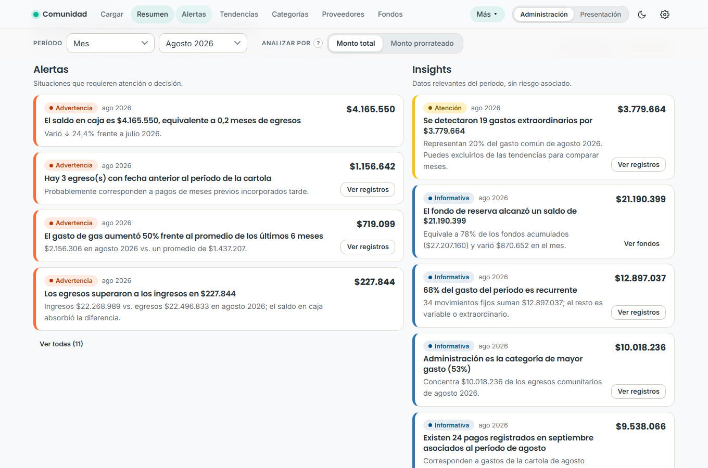 | 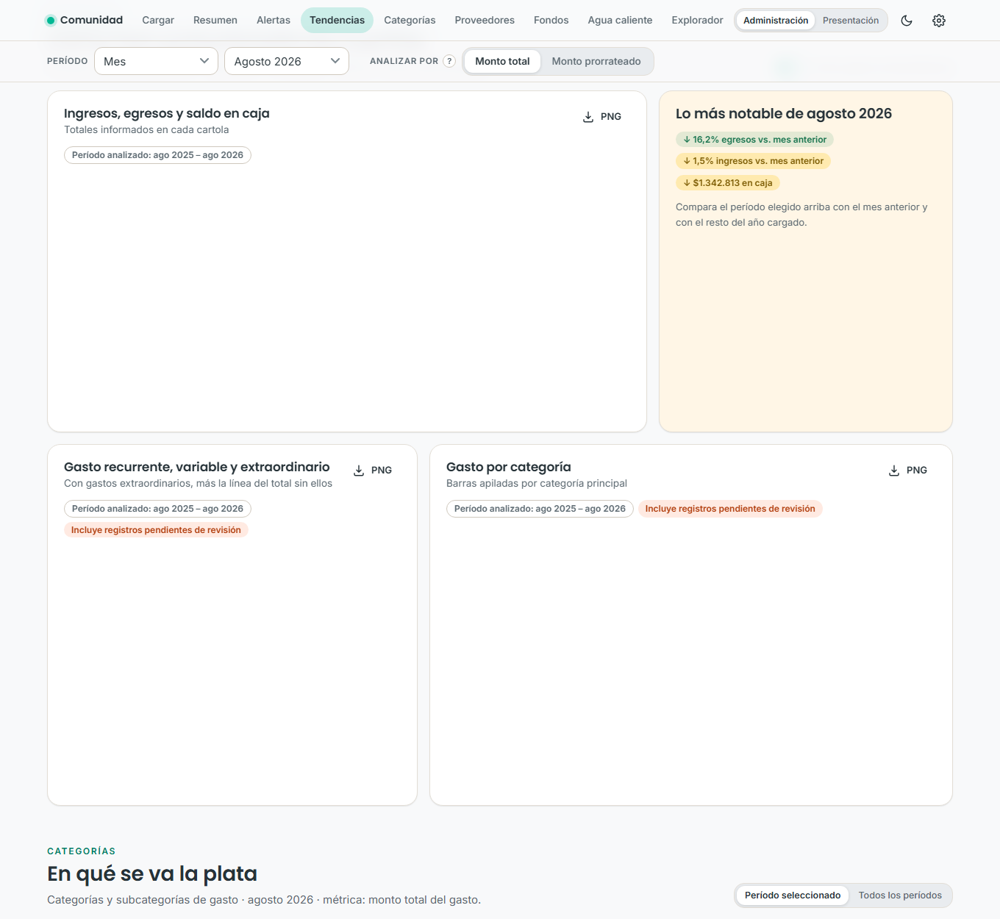 |
| **Alertas e insights** | **Tendencias** |
| 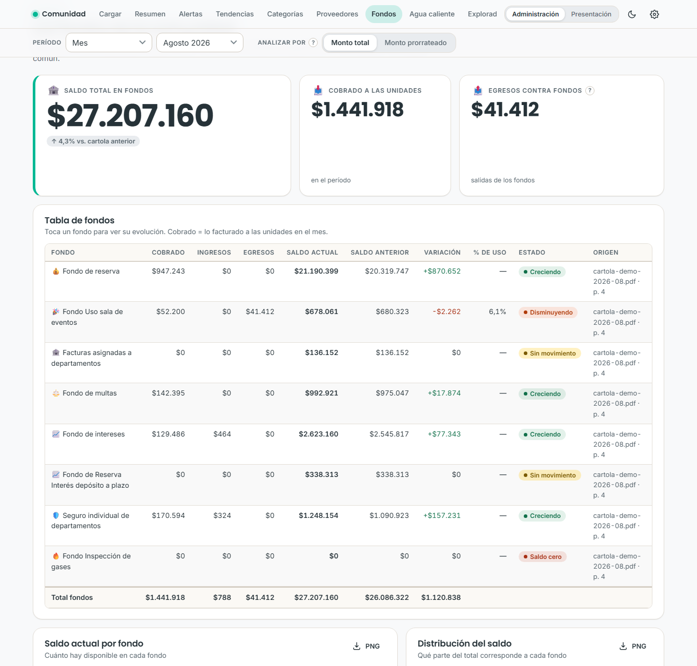 | 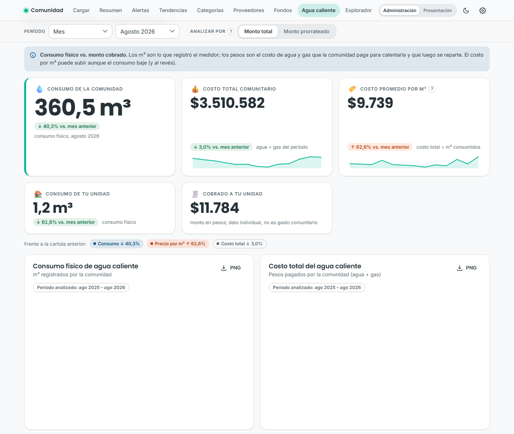 |
| **Fondos** | **Agua caliente** |
| 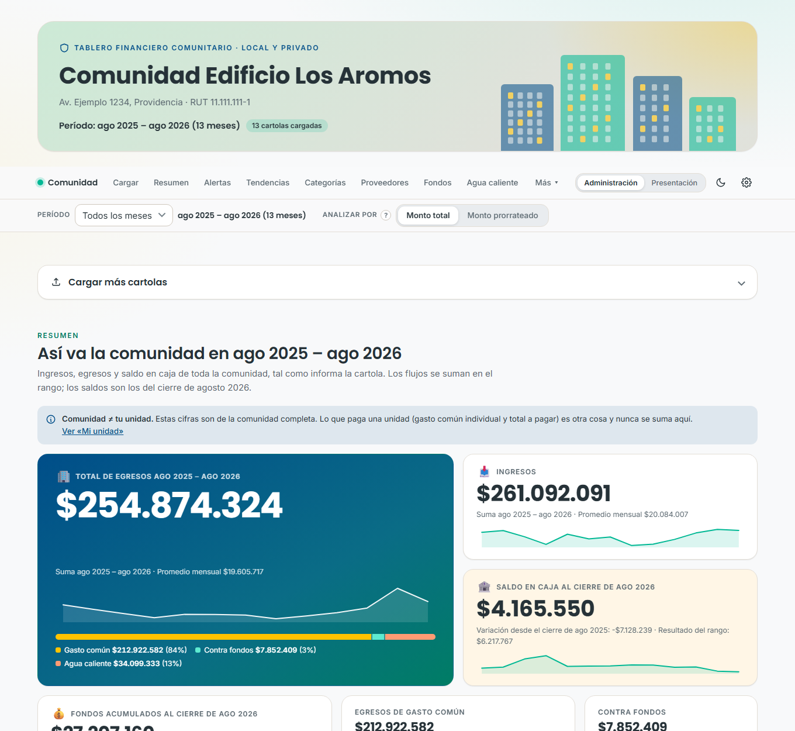 | 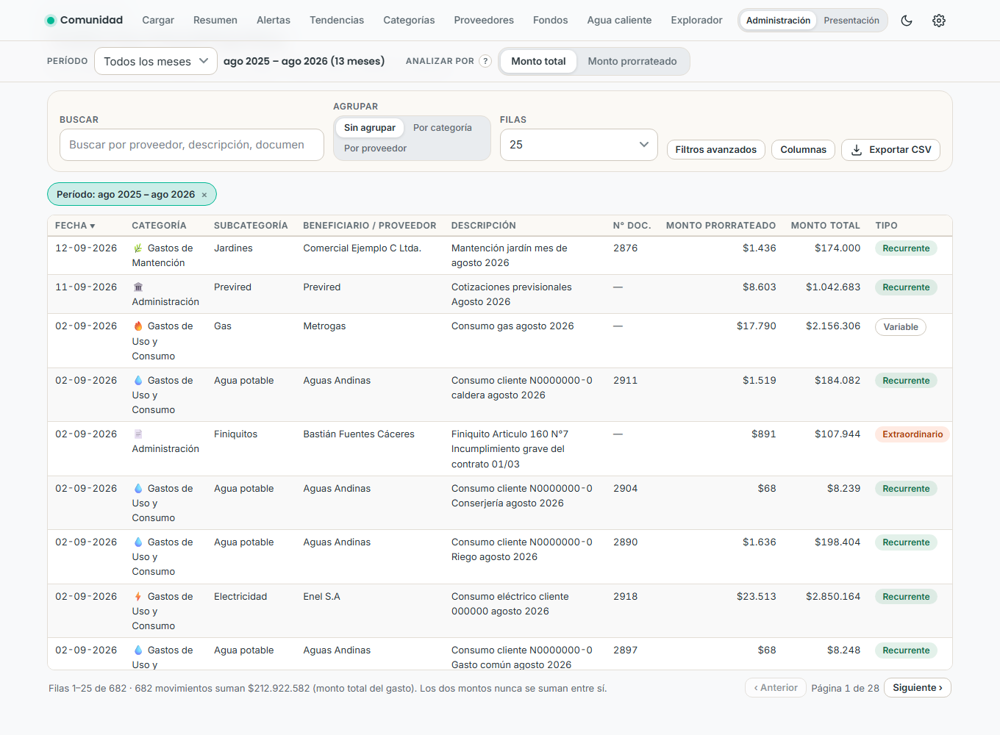 |
| **Rango "Todos los meses"** | **Tabla de movimientos** |
| 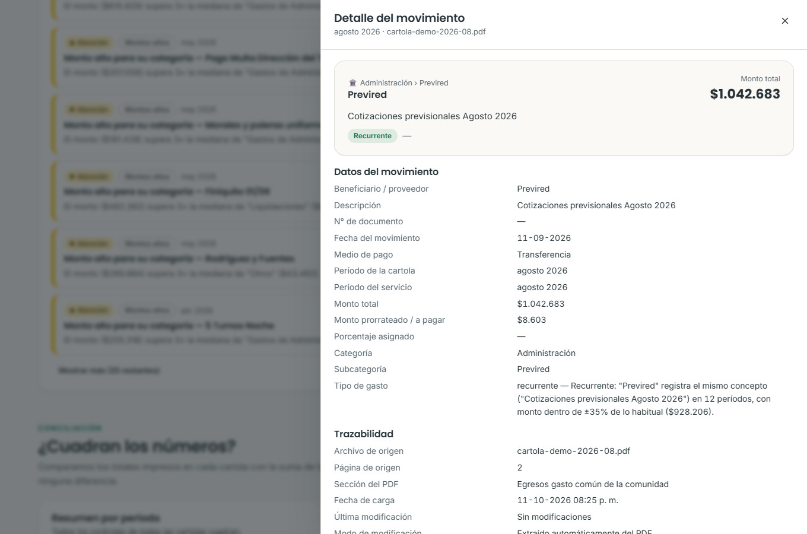 | 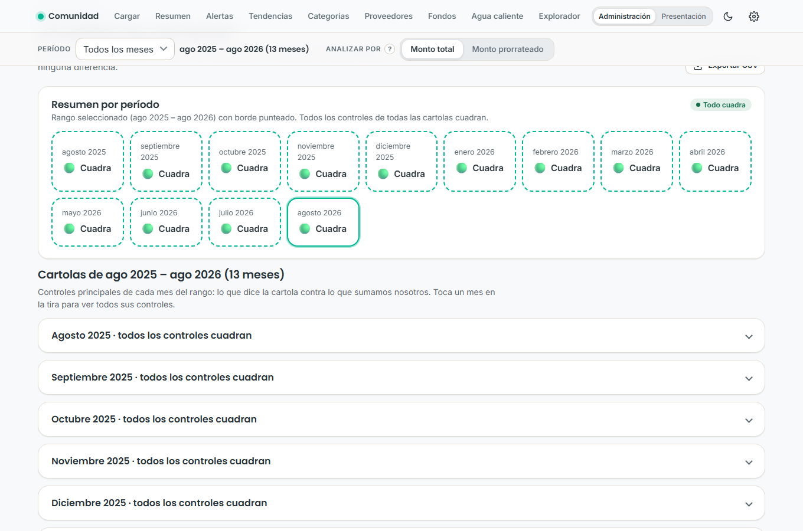 |
| **Detalle y trazabilidad** | **Conciliación** |
| 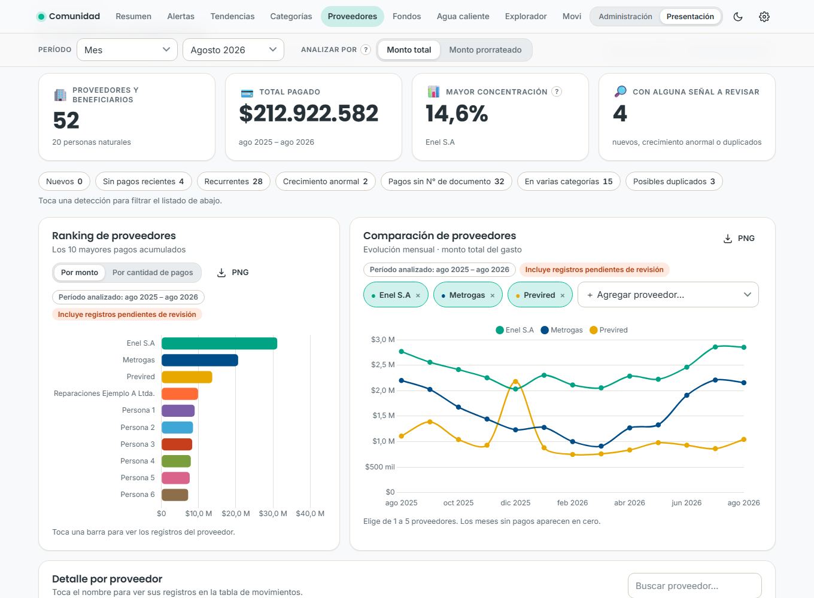 | 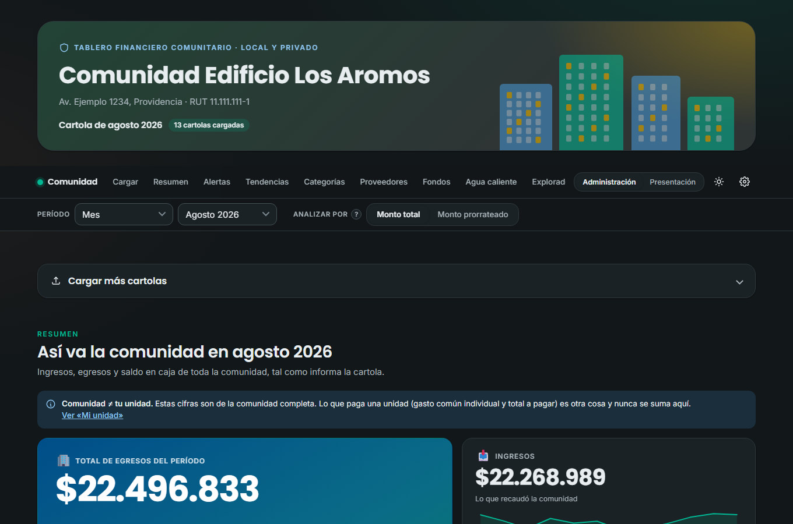 |
| **Modo presentación (personas anonimizadas)** | **Modo oscuro** |

---

## Privacidad

- **Sin internet:** el archivo funciona 100% offline. No usa CDN, analítica ni servicios de OCR o IA externos. Todas las librerías van dentro del HTML.
- **Buscar actualizaciones (opcional):** solo cuando presionas ese botón (en Ajustes o al pie de la página), el dashboard consulta la API pública de GitHub para saber cuál es la última versión publicada. La consulta no envía cookies ni datos de tus cartolas; GitHub solo ve que alguien pidió la versión. Es la única conexión que la página permite; cualquier otra está bloqueada. Sin conexión, el dashboard sigue funcionando igual.
- **Sin servidor:** se abre directamente desde tu disco (`file://`).
- **Almacenamiento local:** los datos se guardan en el navegador (IndexedDB), solo en tu equipo. Cada navegador guarda lo suyo: si abres el archivo en otro navegador, aparecerá vacío.
- **Modo presentación:** oculta nombres de personas, números de documento, RUT, unidad, residente, datos bancarios y observaciones.
- **Exportaciones:** te avisa antes de exportar información sensible, y el reporte para asamblea permite excluir nombres y detalles individuales.

## Limitaciones conocidas

- **Formato:** solo lee cartolas de **Comunidad Feliz**. El lector se calibró con cartolas reales de una comunidad. Otras comunidades o cambios de diseño del PDF pueden leerse mal; en ese caso la sección **Conciliación** muestra diferencias.
- **Clasificaciones automáticas:** las subcategorías inferidas, la separación recurrente/extraordinario y la detección de personas son heurísticas y pueden equivocarse. Todas se pueden corregir a mano.
- **Una comunidad por navegador:** si cargas cartolas de dos comunidades distintas en el mismo navegador, sus cifras se mezclan.
- **Navegadores:** probado principalmente en Microsoft Edge (Chromium). En Firefox y Safari el almacenamiento de archivos locales puede comportarse distinto.
- **Formatos de entrada:** no se lee Excel (.xlsx). El CSV que se importa es solo el que exporta el propio dashboard.

---

## Desarrollo

El archivo `dashboard-comunidad.html` se genera desde el código en `src/`. Necesitas Node.js solo para construirlo; el archivo final no lo necesita.

```bash
npm install
npm run build   # genera dashboard-comunidad.html
npm test        # pruebas con la demo anonimizada
```

| Ruta | Contenido |
|---|---|
| `src/js/parser.js` | Lectura de la cartola por coordenadas: secciones, jerarquía de categorías, monto a pagar y monto total. |
| `src/js/model.js`, `src/js/analysis.js` | Vista derivada, conciliación, duplicados, clasificación, insights y rangos de períodos. |
| `src/js/ui/` | Secciones de la interfaz. |
| `src/css/app.css` | Estilos (tema claro y oscuro). |
| `tools/build.js` | Une todo en un único HTML, con librerías y fuentes embebidas. |
| `tools/test-*.js` | Pruebas: análisis, rangos y regresión (con la demo); parser (requiere tus propios PDF). |
| `tools/generar-demo.js` | Genera la demo anonimizada a partir de cartolas reales interpretadas. |
| `demo/` | Datos ficticios para pruebas, capturas y para probar el dashboard. |
| `docs/ARQUITECTURA.md` | Contratos entre módulos. |
| `docs/REQUERIMIENTOS.md` | Requerimientos originales del proyecto. |

**Pruebas del lector de PDF:** coloca tus propias cartolas en `Datos_Ejemplo/` (carpeta excluida del repositorio) y ejecuta `node tools/test-parser.js`. Verifica que cada cartola cuadre contra sus totales impresos.

**Librerías incluidas:** [pdf.js](https://mozilla.github.io/pdf.js/) (Apache 2.0), [Chart.js](https://www.chartjs.org/) (MIT) y las fuentes [Poppins](https://fonts.google.com/specimen/Poppins) e [Inter](https://rsms.me/inter/) (SIL Open Font License).

## Licencia

[MIT](LICENSE). El software se entrega "tal cual", sin garantías de ningún tipo.
